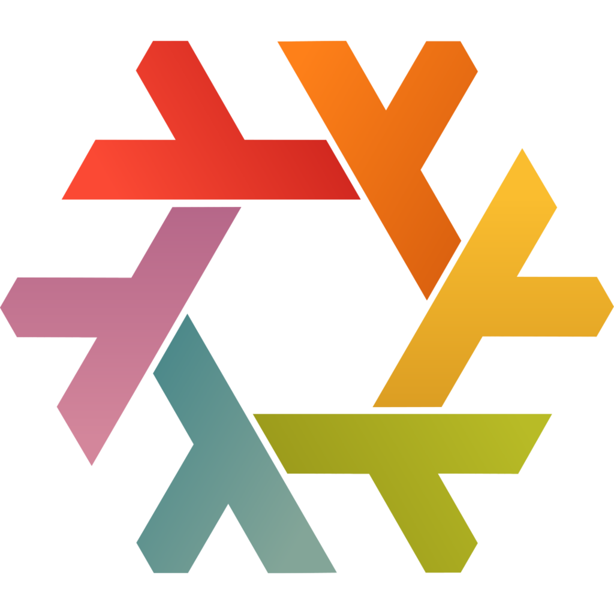

<!-- rumdl-disable MD033 MD041 -->

  
  

  # adam0's infra

  NixOS and Home Manager configuration for my desktop, laptop and homelab server.

  
   
  
  
  
  
  
  

  [Machines](#machines) - [Configuration](#configuration) - [Layout](#layout) - [Making changes](#making-changes)

<!-- rumdl-enable MD033 MD041 -->

This repo contains the NixOS and Home Manager configuration for my `desktop`,
`laptop` and `euclid` server.

If you want to use parts of it, check the hardware settings, disk layouts and
secrets first. Those are configured for these machines, so they will need
changes before using them on another system.

## Machines

| Host | Purpose | Configuration |
| --- | --- | --- |
| `desktop` | Desktop | [Desktop configuration](modules/hosts/desktop/) |
| `laptop` | Laptop | [Laptop configuration](modules/hosts/laptop/) |
| `euclid` | Homelab server | [Server configuration](modules/hosts/euclid/) |

## Configuration

The desktop and laptop use Hyprland with UWSM, Noctalia Shell and tuigreet.
Stylix handles theming, and the application configuration includes Zen Browser,
Neovim, Fish and the other programs in [`modules/programs/`](modules/programs/).

The server configuration includes Traefik, Authentik, WireGuard and CrowdSec,
with databases, notifications and container services. The server's service
imports are in
[`modules/hosts/euclid/default.nix`](modules/hosts/euclid/default.nix).

Disko defines the disk layouts in
[`modules/profiles/partitioning/`](modules/profiles/partitioning/). Secrets
are stored in `secrets.yaml` and loaded through SOPS Nix. The system expects an
existing Age key at `/var/lib/sops-nix/key.txt`; it does not generate one.

## Layout

| Path | What is there |
| --- | --- |
| [`modules/hosts/`](modules/hosts/) | Host configuration and hardware settings |
| [`modules/profiles/`](modules/profiles/) | Base, personal, server and gaming profiles, partitioning and theming |
| [`modules/desktop/`](modules/desktop/) | Hyprland, Noctalia, login and desktop settings |
| [`modules/programs/`](modules/programs/) | Application and shell configuration |
| [`modules/services/`](modules/services/) | Networking, security, storage and server services |
| [`modules/nix/`](modules/nix/) | Nix, Home Manager, secrets, boot and input configuration |
| [`modules/development/`](modules/development/) | Development shell and formatter configuration |
| [`modules/pkgs/`](modules/pkgs/) | Local packages, overlays and helper scripts |
| [`lib/`](lib/) | Helper functions used by the modules |
| [`vars.nix`](vars.nix) | Shared user, locale and domain settings |
| [`assets/`](assets/) | README images |

## Making changes

For a machine-specific change, start in [`modules/hosts/`](modules/hosts/).
The desktop and laptop import the `personal` and `gaming` profiles; `euclid`
imports `server`. The profiles select the application and service modules for
each setup.

The flake uses `flake-parts` and `import-tree` to load the files under
`modules/`. Defining a named NixOS or Home Manager module does not enable it;
it still needs to be imported by a host or profile.

`flake.nix` is generated by `flake-file`. Input declarations are kept in the
module files, including [`modules/nix/dendritic.nix`](modules/nix/dendritic.nix),
so make input changes there and regenerate the flake rather than editing the
generated file.
